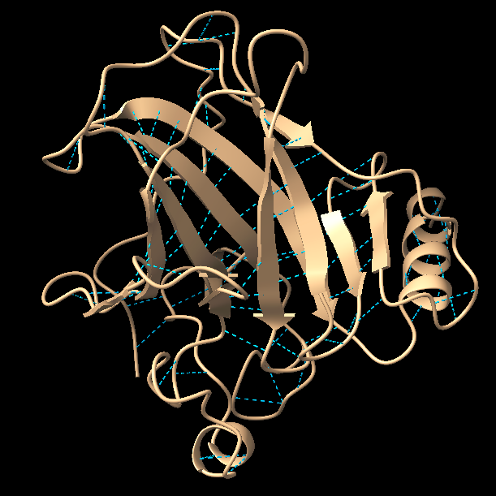
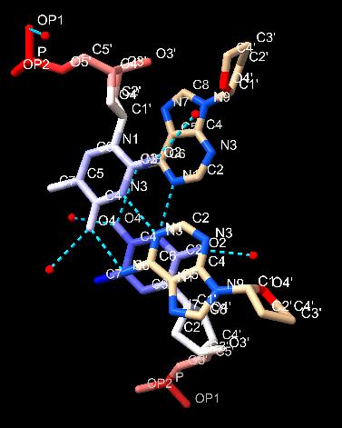
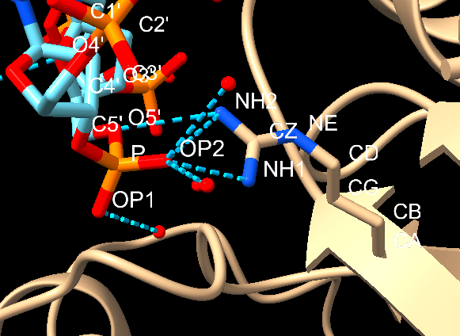

# Scientist’s Mission

[GitHub profile](https://github.com/mrhedg-42)

# Who Stole TP53’s Superpower? Searching for the Key to Unlock Cancer

*Using AI to Uncover the Secrets of TP53–DNA Interactions*

## 1. The LEGO Assembly Line

**Question:** What type of bond links amino acids together to form a protein? Which amino acids form hydrogen bonds with each other?

**Answer:**

1. Peptide bonds link amino acids together to form a protein. They form between the amino group of one amino acid and the carboxyl group of another.
2. Hydrogen bonds form between amino acids whose side chains (R groups) can donate or accept hydrogen bonds, such as serine, threonine, asparagine, glutamine, and tyrosine. In protein secondary structures, hydrogen bonds also form between the backbone C=O and N–H groups of different amino acid residues, stabilizing α-helices and β-sheets.

## 2. The Double-Track Highway of Life’s Blueprint

**Question:** How do nucleotides assemble to form double-stranded DNA? What are the basic structural components of DNA? Is DNA right-handed or left-handed? List the names of the four DNA bases. Which bases form hydrogen bonds with each other?

**Answer:**

*Add the answer to this section here.*

## 3. Searching for My One-and-Only Soulmate in the Universe: A 20-Base-Pair Love Code Hidden Among 3 Billion DNA Base Pairs

**The source of molecular stability and specificity: hydrogen bonding — How do TP53 and DNA recognize each other?**

**Question:** Using the structure 3KMD, identify one pair of an amino acid and a DNA base that interact with each other.

**Answer:**

1. **DNA binding:** The TP53 gene encodes the p53 protein, a transcription factor that binds to specific DNA sequences to regulate genes involved in cell-cycle arrest, DNA repair, and apoptosis.
2. **Hydrogen bonding:** Amino acid side chains in p53 form hydrogen bonds with specific chemical groups on DNA bases. These interactions help p53 recognize particular DNA sequences.
3. **Molecular specificity:** The arrangement of hydrogen-bond donors and acceptors on DNA bases, together with the shape and chemical properties of the protein, allows p53 to recognize its target DNA sequences.
4. **Additional interactions:** p53 also uses electrostatic interactions with the negatively charged DNA backbone, van der Waals forces, and shape complementarity to stabilize binding.
5. **Biological importance:** When DNA damage occurs, p53 can activate genes that stop cell division, promote DNA repair, or trigger programmed cell death if the damage is severe.

## 4. Return to the Crime Scene

**Question:** Why can a mutation (change) in just one amino acid of a protein sometimes lead to a serious human disease? Give one specific example of such a disease.

**Answer:**

A mutation in just one amino acid can cause a serious disease because it may change a protein’s shape, chemical properties, stability, or function. Even a single amino acid can be essential for the protein to work properly or interact with other molecules.

## 5. Return to the Crime Scene: Searching for Clues

**Question:** Using the TP53–DNA structure (3KMD), identify one TP53 amino acid mutation that can lead to uncontrolled cell division and contribute to the development of cancer.

Then examine this amino acid in ChimeraX. Based on its three-dimensional position, determine whether the mutated amino acid is located directly at the protein–DNA interface or somewhere else in the protein.

**Answer:**

**a.** Paste a screenshot of your ChimeraX visualization here.

**b.** Save your ChimeraX session file as `StudentID.cxs`.
